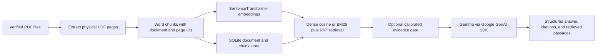

# Regulatory hugging face for Campus Buddies

<p align="center">
  
</p>

<p align="center"><strong>CampusReg</strong> — an evidence-first campus regulations assistant built around official documents, page-level citations, and clear abstention.</p>

<p align="center">
  <a href="https://colab.research.google.com/github/VenkateshReddy007/CampusComply/blob/main/notebooks/02_rag_starter_kit.ipynb"></a>
  <a href="LICENSE"></a>
  <a href="https://github.com/VenkateshReddy007/CampusComply"></a>
</p>

**CampusReg implements Problem Statement 2A — Campus Regulations Assistant** from the [Hacktoberfest RAG Application with Gemma challenge](https://github.com/mithun-srinivas/HacktoberFest-HackDay/blob/main/problem-statements/02_rag_application.md). Students often need to search long handbooks and regulations spread across multiple documents. CampusReg retrieves passages from PDFs supplied by the user, asks Gemma to answer from those passages, and returns document-and-page citations alongside the actual evidence.

> **Current status:** the shared Python RAG core, FastAPI backend, and Next.js interface are implemented and covered by synthetic software tests. No official campus PDFs or human-reviewed policy evaluation set are bundled, so policy correctness and production conflict detection remain unmeasured. The API key is supplied by each local operator; no hosted demo is configured.

[Problem statement](https://github.com/mithun-srinivas/HacktoberFest-HackDay/blob/main/problem-statements/02_rag_application.md) · [Architecture](docs/architecture.md) · [Baseline audit](docs/baseline-audit.md) · [Evaluation guide](evaluation/README.md) · [Backend guide](backend/README.md)

## The problem

The challenge asks for an assistant that answers questions about campus rules using official institutional documents, cites the source document and page, and declines questions the documents do not answer. Example source collections include a student handbook, examination regulations, hostel rules, and library policies. CampusReg expects those documents to be supplied by the institution or user; it does not ship sample rules as real policy.

## The solution

The same installable Python package powers local use and the Colab notebook. The pipeline keeps page and document identity attached from PDF ingestion through retrieval, then exposes the exact retrieved passages used for generation.



The Colab notebook is a lightweight demo client for this shared core. It can launch its Gradio interface with public sharing disabled. To try it, bring your own authorized campus PDFs and Google AI Studio API key.

## What is distinctive about this implementation

- **Citations trace to the source PDF.** Extracted pages preserve physical one-based PDF page numbers. Each retrieved passage carries its document ID, filename, page, chunk ID, original text, and retrieval diagnostics.
- **Answers expose their evidence.** The passages returned to the caller are the passages sent to Gemma. Citation formatting is checked against retrieved sources; that check alone does not prove a claim is supported.
- **Abstention is explicit.** Results distinguish an answer, an evidence-based abstention, and a generation failure. Optional relevance cutoffs are configuration-specific retrieval thresholds, not probabilities that an answer is correct.
- **Multiple sources persist together.** SQLite stores document metadata, content hashes, pages, chunks, vectors, and conversation history. Duplicate PDF content is detected by hash; delete and re-index operations preserve other documents.
- **Retrieval choices can be measured.** Dense cosine retrieval remains available as the baseline. BM25 with Reciprocal Rank Fusion can be compared without mixing uncalibrated scores.
- **Evaluation separates software behavior from policy quality.** The package supports retrieval experiments, paired RAG/no-RAG runs, evidence-gate calibration, follow-up evaluation, and fixed-evidence Gemma comparison. Factual answer and citation-support labels require human review.
- **Potential conflicts show both sources.** A separate comparison service validates each passage quote, source identity, page, scope excerpt, and date before returning a report. It requires human review and never selects the controlling rule.
- **A source knowledge graph exposes provenance.** The graph links each indexed document to its physical PDF pages and exact passages. It does not infer semantic relationships between rules.
- **The local interface uses the API contract.** The Next.js app uploads PDFs, manages documents and conversations, displays returned answer evidence, checks cross-document differences, and exposes protected development evaluation jobs.

These are project design choices, not a claim that the approach is the first of its kind. Conflict labels are review prompts rather than institutional determinations.

## Why build this in 2026?

Students already encounter policy information as long PDFs, revised handbooks, and separate departmental documents. A fluent answer is easy to produce; a dependable answer needs its source, page, current evidence, and a way to say “the documents do not establish this.” CampusReg puts those checks in the design and makes the retrieval and answer-quality experiments reproducible as a reviewed policy dataset becomes available.

## Current scope and limits

| Implemented and software-tested | Not included or not yet measured |
| --- | --- |
| Shared Python RAG package and Colab notebook clients | OCR for scanned or image-only PDFs |
| PDF extraction, word chunks, SentenceTransformer embeddings, dense and BM25/RRF retrieval | Official institutional PDF corpus and reviewed policy question set |
| SQLite multi-document storage with physical page metadata, hashes, deletion, and re-indexing | Human-reviewed answer correctness, retrieval, and refusal scores |
| FastAPI API and Next.js App Router frontend | Production authentication, authorization, tenancy, and deployment hardening |
| Evidence validation, abstention interfaces, isolated contextual conversations | Independently measured conflict precision/recall on real regulations |
| Structured potential-conflict reports showing both validated passages | Hosted public demo and real model comparison results |
| Development evaluation jobs protected by a backend bearer token | Privacy, legal, or DPDP compliance certification |

Similarity and fusion scores are retrieval diagnostics, not calibrated probabilities. The evidence gate needs reviewed validation data and separate calibration for the chosen retrieval configuration. Scanned PDFs are rejected because OCR is not implemented. Treat generated answers as an aid to locating official text, not a replacement for the institution’s authoritative policy or staff guidance.

The assistant is scoped to campus compliance questions and is instructed to abstain from unrelated requests. The local UI does not show an API-key warning until a user invokes an action that needs generation; a missing or invalid key then appears as a structured request error, never as an answer.

### Source-grounded question starters

These prompts are templates, not claims that a particular rule exists. Replace bracketed terms with wording found in the official PDFs you indexed:

- `Which requirements are stated in the indexed documents?`
- `Which page mentions [topic or requirement]?`
- `What exceptions does the source list for [requirement]?`
- `Do the indexed documents describe [topic] differently for [group or situation]?`

The answer and visible evidence depend on the indexed source material. Local software fixtures are visibly labelled and must not be used as real regulations or policy evaluation data.

### Model selection and routing

The current Google GenAI integration uses the configured Gemma 4 model; it does not pretend to route among Gemma 2, 3, and 4. Google's hosted Gemma API documentation currently lists Gemma 4 `gemma-4-31b-it` and `gemma-4-26b-a4b-it` and requires an API key. Gemma 2/3 routing needs separately configured, tested inference endpoints and an explicit routing policy. No such endpoints are configured here, so no model is silently substituted. See [Google's hosted Gemma model list](https://ai.google.dev/gemma/docs/core/gemma_on_gemini_api).

## Baseline and notebooks

The shared core preserves the starter notebook’s baseline settings:

| Setting | Baseline |
| --- | --- |
| Gemma model | `gemma-4-26b-a4b-it` |
| Embedding model | `sentence-transformers/all-MiniLM-L6-v2` |
| Chunk size | 120 words |
| Chunk overlap | 30 words |
| Retrieval top-k | 3 |
| Temperature | 0.2 |
| Retrieval | Dense cosine similarity |

Open the [shared-core Colab notebook](https://colab.research.google.com/github/VenkateshReddy007/CampusComply/blob/main/notebooks/02_rag_starter_kit.ipynb) to use the package, or browse the [notebook source](notebooks/02_rag_starter_kit.ipynb). The [baseline reference notebook](notebooks/02_rag_starter_kit_baseline.ipynb) preserves the starter logic for comparison. Notebook outputs are cleared in the committed copies: the original baseline contained token-like output from a secret lookup, so retaining saved runtime output could expose credentials. The synthetic starter sample is labelled as synthetic and is not presented as campus policy.

## Run the local application

Use Python 3.11+ and Node.js 20.9+. From the repository root:

```powershell
python -m pip install -e ".\backend[all]"
cd frontend
npm install
```

In terminal 1, start the API:

```powershell
$env:CAMPUSREG_CORS_ORIGINS = "http://localhost:3000,http://127.0.0.1:3000"
python -m uvicorn campusreg.main:app --app-dir backend --host 127.0.0.1 --port 8000
```

In terminal 2, start the web app with `cd frontend; npm run dev`.
Open [http://localhost:3000](http://localhost:3000). The API and schema are at
[http://127.0.0.1:8000](http://127.0.0.1:8000) and
[/docs](http://127.0.0.1:8000/docs). The frontend reads
`NEXT_PUBLIC_CAMPUSREG_API_URL`, defaulting to the local API. Set
`GOOGLE_API_KEY` in the backend process environment for Gemma answers and
model-assisted conflict reports. Document management works without the key;
generation-dependent actions return a structured configuration error until
it is set. The first PDF upload downloads the configured embedding model if it
is not already cached.

For a clearly synthetic UI exercise, run
`python scripts/create_synthetic_demo_pdfs.py`; generated files appear in
`data/synthetic_demo/` and are ignored by Git. They contain invented values
marked as software fixtures, not campus rules. Never use them for policy
evaluation. In Colab, add a key to **Secrets**; do not paste credentials into
source code, notebook output, README, issues, or commits. The provider accepts
`GOOGLE_API_KEY`, `GEMMA_API_KEY`, and the legacy Colab secret name
`gemma_API_Key`. Safe variable names and placeholders are in `.env.example`.

Full evaluations are explicit commands and can make model requests. They do not run on import or application startup. The mock smoke tests do not call Gemma. Review [evaluation/README.md](evaluation/README.md) before preparing a real dataset or launching a full run.

## Results that have actually been measured

Checks run locally on 2026-10-24. The backend suite passed **85 tests**
(6.89 seconds; one Starlette pending-deprecation warning). Frontend tests
passed **7 tests**; lint, type-check, and production build passed. A local API
smoke check returned HTTP 200 for the web app and API health endpoint. Two
clearly labelled synthetic PDFs indexed as one page and one chunk each, with
384-dimensional embeddings. API readiness correctly reported degraded because
no model API key is configured. See [docs/evaluation-report.md](docs/evaluation-report.md)
for exact commands and scope. These are software checks, not campus-policy
accuracy measurements.

```text
Backend: python -m pytest tests -q              85 passed, 1 warning (6.89s)
Frontend: npm test                              7 passed
Frontend: npm run lint                          passed
Frontend: npm run typecheck                    passed
Frontend: npm run build                        passed
```

Tests use synthetic fixtures and mocked model calls. They do not measure
campus-policy accuracy. No retrieval benchmark, human-reviewed answer-quality
score, real-data conflict precision/recall, or live Gemma comparison is
reported because this checkout has no official campus corpus or reviewed
question set. Notebook outputs remain empty for credential safety; no result
has been inserted by hand.

## Open source and API-key handling

CampusComply is released under the [Apache License 2.0](LICENSE). You can inspect, fork, adapt, and contribute to the code under that license. CampusReg does not include a shared API key. Each user supplies their own Google AI Studio credential through a local environment/secret store or Colab Secrets. The key stays out of source code and answer responses. Requests that use Gemma send the current question and retrieved passages to the configured Google GenAI service; only submit documents you are authorized to process there.

## DPDP and Privacy RAG

India's [Digital Personal Data Protection Act, 2023](https://www.meity.gov.in/static/uploads/2024/06/2bf1f0e9f04e6fb4f8fef35e82c42aa5.pdf) and the [Digital Personal Data Protection Rules, 2025](https://www.meity.gov.in/static/uploads/2025/11/53450e6e5dc0bfa85ebd78686cadad39.pdf) are official sources for the country's digital personal-data framework. CampusReg is an educational prototype; it is not legal advice, a compliance assessment, or a DPDP certification.

### What Privacy RAG means here

CampusReg narrows the normal generation payload to the current question and retrieved excerpts instead of sending the full PDF to Gemma. Source PDFs, extracted passages, vectors, and conversation messages persist in the configured local SQLite database. Follow-up query rewriting can use bounded recent conversation context. The Google API key stays in the local runtime environment and is not included in answers or notebook outputs.

Those choices reduce unnecessary context sharing, but they do not make the prototype private by default or DPDP-compliant. When Gemma is enabled, the question and selected passages (and bounded context for a follow-up rewrite) go to the configured Google GenAI service. SQLite data is not encrypted by this project. Storage methods can delete a document or clear conversation history, but there is no user-facing retention/deletion workflow, production authentication, authorization, institution-level tenant isolation, or documented notice/consent process. **Do not use it with identifiable student records or other personal data in production.** Before institutional deployment, have the privacy/legal team review the applicable Act and Rules, data flows, provider terms, access controls, retention, and data-principal rights processes.

## Contributors and demo links

| Photo | Contributor | GitHub | Project demo |
| --- | --- | --- | --- |
|  | Rohan Chand M | [@rohan-chand-m-01](https://github.com/rohan-chand-m-01) | [Open the Colab notebook](https://colab.research.google.com/github/VenkateshReddy007/CampusComply/blob/main/notebooks/02_rag_starter_kit.ipynb) |
|  | Venkatesh Reddy K | [@VenkateshReddy007](https://github.com/VenkateshReddy007) | [CampusComply repository](https://github.com/VenkateshReddy007/CampusComply) · [Open the Colab notebook](https://colab.research.google.com/github/VenkateshReddy007/CampusComply/blob/main/notebooks/02_rag_starter_kit.ipynb) |

The local web interface is the application entry point; question answering and model-assisted conflict checks require a user-provided API key and PDFs from an official source. There is no hosted live demo URL.

## Repository map

```text
backend/campusreg/       shared ingestion, RAG, source graph, conflict, storage, API, and evaluation code
backend/tests/           unit and mocked API integration tests
frontend/                Next.js App Router, TypeScript, Tailwind, and UI components
notebooks/               shared-core Colab notebook and baseline reference
evaluation/              schemas, question template, methodology, result placeholder
docs/                    architecture, phase notes, coverage and failure reports
data/                    local data location; uploaded documents and databases are ignored
```

See [backend/README.md](backend/README.md) for API and Colab setup details, [docs/architecture.md](docs/architecture.md) for design boundaries, and [evaluation/README.md](evaluation/README.md) for dataset preparation, metrics, calibration, and benchmark commands.
