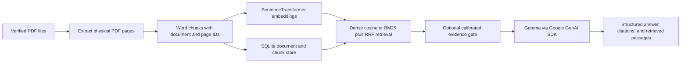

# Regulatory hugging face for Campus Buddies

<p align="center">
  
</p>

<p align="center"><strong>CampusReg</strong> — an evidence-first campus regulations assistant built around official documents, page-level citations, and clear abstention.</p>

<p align="center">
  <a href="https://colab.research.google.com/github/VenkateshReddy007/CampusComply/blob/main/notebooks/02_rag_starter_kit.ipynb"></a>
  <a href="LICENSE"></a>
  <a href="https://github.com/VenkateshReddy007/CampusComply"></a>
</p>

**CampusReg implements Problem Statement 2A — Campus Regulations Assistant** from the [Hacktoberfest RAG Application with Gemma challenge](https://github.com/mithun-srinivas/HacktoberFest-HackDay/blob/main/problem-statements/02_rag_application.md). Students often need to search long handbooks and regulations spread across multiple documents. CampusReg retrieves passages from PDFs supplied by the user, asks Gemma to answer from those passages, and returns document-and-page citations alongside the actual evidence.

> **Prototype status:** the shared Python RAG core and Colab notebook are present. This repository does not yet include a FastAPI application, a standalone web frontend, or a hosted public demo. No official campus PDFs or reviewed evaluation questions are bundled.

[Problem statement](https://github.com/mithun-srinivas/HacktoberFest-HackDay/blob/main/problem-statements/02_rag_application.md) · [Architecture](docs/architecture.md) · [Baseline audit](docs/baseline-audit.md) · [Evaluation guide](evaluation/README.md) · [Backend guide](backend/README.md)

## The problem

The challenge asks for an assistant that answers questions about campus rules using official institutional documents, cites the source document and page, and declines questions the documents do not answer. Example source collections include a student handbook, examination regulations, hostel rules, and library policies. CampusReg expects those documents to be supplied by the institution or user; it does not ship sample rules as real policy.

## The solution

The same installable Python package powers local use and the Colab notebook. The pipeline keeps page and document identity attached from PDF ingestion through retrieval, then exposes the exact retrieved passages used for generation.



The Colab notebook is a lightweight demo client for this shared core. It can launch its Gradio interface with public sharing disabled. To try it, bring your own authorized campus PDFs and Google AI Studio API key.

## What is distinctive about this implementation

- **Citations trace to the source PDF.** Extracted pages preserve physical one-based PDF page numbers. Each retrieved passage carries its document ID, filename, page, chunk ID, original text, and retrieval diagnostics.
- **Answers expose their evidence.** The passages returned to the caller are the passages sent to Gemma. Citation formatting is checked against retrieved sources; that check alone does not prove a claim is supported.
- **Abstention is explicit.** Results distinguish an answer, an evidence-based abstention, and a generation failure. Optional relevance cutoffs are configuration-specific retrieval thresholds, not probabilities that an answer is correct.
- **Multiple sources persist together.** SQLite stores document metadata, content hashes, pages, chunks, vectors, and conversation history. Duplicate PDF content is detected by hash; delete and re-index operations preserve other documents.
- **Retrieval choices can be measured.** Dense cosine retrieval remains available as the baseline. BM25 with Reciprocal Rank Fusion can be compared without mixing uncalibrated scores.
- **Evaluation separates software behavior from policy quality.** The package supports retrieval experiments, paired RAG/no-RAG runs, evidence-gate calibration, follow-up evaluation, and fixed-evidence Gemma comparison. Factual answer and citation-support labels require human review.

These are engineering choices for this project, not a claim that the approach is the first of its kind. Potentially conflicting policies are represented in the evaluation format, but an end-to-end conflict detector and conflict-resolution workflow are not yet implemented.

## Why build this in 2026?

Students already encounter policy information as long PDFs, revised handbooks, and separate departmental documents. A fluent answer is easy to produce; a dependable answer needs its source, page, current evidence, and a way to say “the documents do not establish this.” CampusReg puts those checks in the design and makes the retrieval and answer-quality experiments reproducible as a reviewed policy dataset becomes available.

## Current scope and limits

| Available in this repository | Not included or not yet measured |
| --- | --- |
| Shared Python RAG package and two Colab notebooks | FastAPI routes and standalone frontend |
| PDF text extraction, overlapping word chunks, SentenceTransformer embeddings, dense cosine retrieval | OCR for scanned or image-only PDFs |
| Multi-PDF SQLite storage with original page metadata, content hashes, duplicate detection, deletion, and re-indexing | Automated policy conflict detection or authority selection |
| Optional BM25/RRF retrieval and calibrated evidence-gate interfaces | Hosted public demo or production deployment controls |
| Isolated conversation history with a fresh retrieval step for follow-ups | Official institutional policy corpus and human-reviewed question set |
| Evaluation framework and mocked software smoke tests | Real benchmark scores for recall, correctness, citations, latency, or model quality |

Similarity and fusion scores are retrieval diagnostics, not calibrated probabilities. The evidence gate needs reviewed validation data and separate calibration for the chosen retrieval configuration. Scanned PDFs are rejected because OCR is not implemented. Treat generated answers as an aid to locating official text, not a replacement for the institution’s authoritative policy or staff guidance.

## Baseline and notebooks

The shared core preserves the starter notebook’s baseline settings:

| Setting | Baseline |
| --- | --- |
| Gemma model | `gemma-4-26b-a4b-it` |
| Embedding model | `sentence-transformers/all-MiniLM-L6-v2` |
| Chunk size | 120 words |
| Chunk overlap | 30 words |
| Retrieval top-k | 3 |
| Temperature | 0.2 |
| Retrieval | Dense cosine similarity |

Open the [shared-core Colab notebook](https://colab.research.google.com/github/VenkateshReddy007/CampusComply/blob/main/notebooks/02_rag_starter_kit.ipynb) to use the package, or browse the [notebook source](notebooks/02_rag_starter_kit.ipynb). The [baseline reference notebook](notebooks/02_rag_starter_kit_baseline.ipynb) preserves the starter logic for comparison. Notebook outputs are cleared in the committed copies: the original baseline contained token-like output from a secret lookup, so retaining saved runtime output could expose credentials. The synthetic starter sample is labelled as synthetic and is not presented as campus policy.

## Run locally

Python 3.11 or newer is required. From the repository root:

```powershell
python -m pip install -e ".\backend[all]"
python -m pytest .\backend\tests -q
```

For the test-only dependencies, install `.\backend[test]`. For embeddings without the notebook UI, use `backend[embeddings]`. First use of SentenceTransformer downloads model weights.

Set `GOOGLE_API_KEY` in your local process environment or an ignored `.env` file for Gemma generation. In Colab, add the key to **Secrets** as `GOOGLE_API_KEY` and grant notebook access. The notebook reads it from Colab Secrets; never paste a key into a code cell, notebook output, README, issue, or commit. The provider accepts `GOOGLE_API_KEY`, `GEMMA_API_KEY`, and the legacy Colab secret name `gemma_API_Key`. Copy `.env.example` only for its safe variable names and placeholders.

Full evaluations are explicit commands and can make model requests. They do not run on import or application startup. The mock smoke tests do not call Gemma. Review [evaluation/README.md](evaluation/README.md) before preparing a real dataset or launching a full run.

## Results that have actually been measured

The automated software suite was run locally on **24 October 2026**:

```text
Command: python -m pytest tests -q   (from backend/)
Result:  70 passed in 2.86s
```

These are software tests using synthetic fixtures and mocked model calls. They do not measure campus-policy accuracy. No retrieval benchmark, human-reviewed answer-quality score, or live Gemma comparison is reported because this checkout has no official campus corpus or reviewed question set. The notebook outputs are intentionally empty for credential safety and reproducibility; no model result has been inserted by hand.

## Open source and API-key handling

CampusComply is released under the [Apache License 2.0](LICENSE). You can inspect, fork, adapt, and contribute to the code under that license. CampusReg does not include a shared API key. Each user supplies their own Google AI Studio credential through a local environment/secret store or Colab Secrets. The key stays out of source code and answer responses. Requests that use Gemma send the current question and retrieved passages to the configured Google GenAI service; only submit documents you are authorized to process there.

## Contributors and demo links

| Contributor | GitHub | Project demo |
| --- | --- | --- |
| Rohan Chand M | [@rohan-chand-m-01](https://github.com/rohan-chand-m-01) | [Open the Colab notebook](https://colab.research.google.com/github/VenkateshReddy007/CampusComply/blob/main/notebooks/02_rag_starter_kit.ipynb) |
| Venkatesh Reddy K | [@VenkateshReddy007](https://github.com/VenkateshReddy007) | [CampusComply repository](https://github.com/VenkateshReddy007/CampusComply) · [Open the Colab notebook](https://colab.research.google.com/github/VenkateshReddy007/CampusComply/blob/main/notebooks/02_rag_starter_kit.ipynb) |

The notebook is the runnable demo entry point; it requires a user-provided API key and official source PDFs. There is no hosted live demo URL yet.

## Repository map

```text
backend/campusreg/       shared ingestion, RAG, storage, and evaluation code
backend/tests/           unit and mocked smoke tests
notebooks/               shared-core Colab notebook and baseline reference
evaluation/              schemas, question template, methodology, result placeholder
docs/                    baseline audit, architecture, and phase notes
data/                    local data location; uploaded documents and databases are ignored
```

See [backend/README.md](backend/README.md) for API and Colab setup details, [docs/architecture.md](docs/architecture.md) for design boundaries, and [evaluation/README.md](evaluation/README.md) for dataset preparation, metrics, calibration, and benchmark commands.
